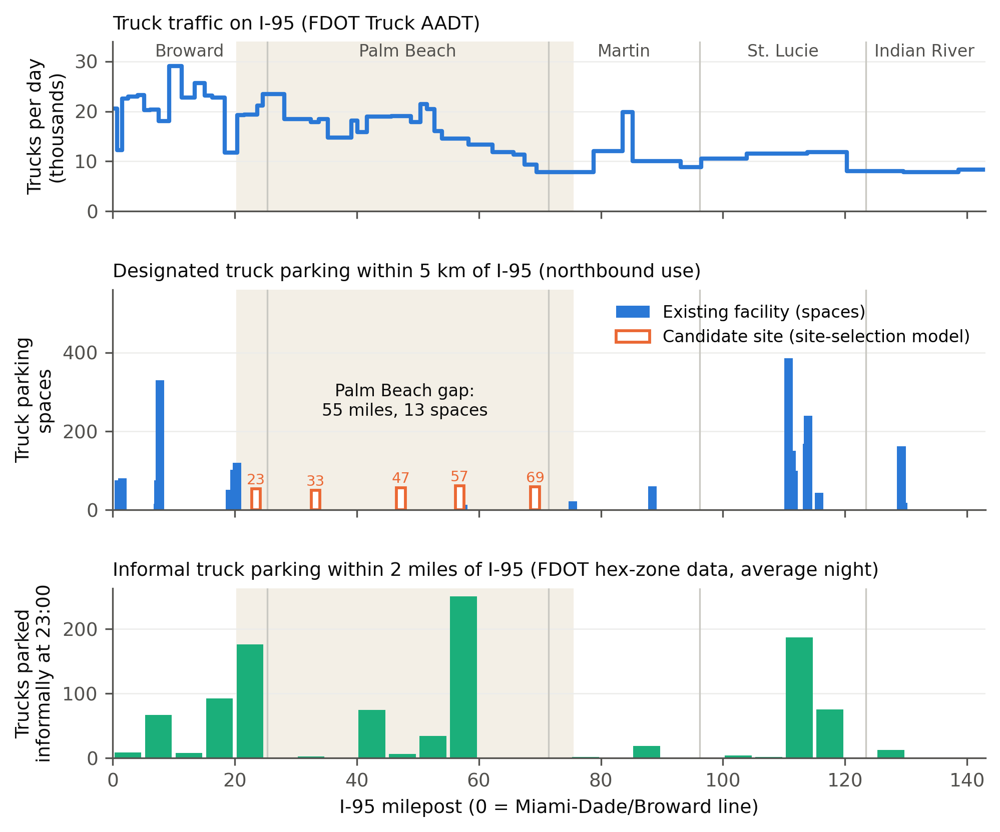
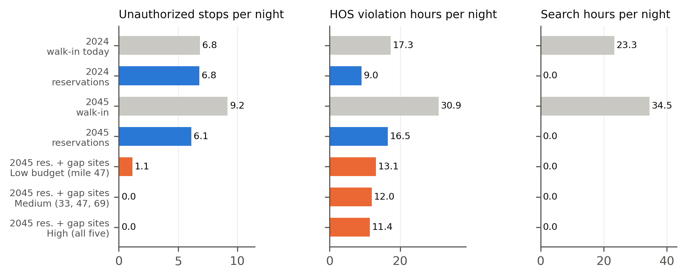

# I-95 Truck Parking Reservation Model (FDOT District 4)

An hours-of-service (HOS) aware truck parking reservation model, applied to FDOT District 4 data for northbound I-95
from the Miami-Dade/Broward line to the Brevard line (142.6 miles, 21 truck parking facilities).

This repository contains the code and summary results. The input data belong to FDOT and are not included.

Author: Soheila Saeidi, Florida Atlantic University

## What the model does

It is a two-stage stochastic mixed-integer program. Before occupancy is known, it decides which trucks get a
reservation at which facility and how many temporary spaces to open. After occupancy is known, each truck gets one
outcome: reservation honored, reallocated to another facility, walk-in parking, legal continuation to its
destination, or an unauthorized stop where its hours run out.

The model is the revised version of the TRB paper model (TRBAM-27-03288), extended after a meeting with FDOT:

| FDOT comment | In the model |
|---|---|
| Drivers search about one hour for parking, within their hours of service | Search time for trucks without a confirmed space (15 min to 1 h, by occupancy), counted against legal driving time |
| I-95 is congested; the same trip can take 1 or 2 hours | Travel time by segment, time of day and day |
| Drivers park on ramps and shoulders when nothing is available | Unauthorized stop is an explicit, counted outcome |
| There is a small buffer in the HOS rules | The adverse driving exception is never planned for (strict HOS) |
| Use real facility capacities | FDOT inventory capacities and observed hourly occupancy (28 day types) |

## Main results

Per night, for 100 trucks that need parking (146 in 2045). Trucks are generated, so these are model estimates.

| | Today (walk-in) | With reservations |
|---|---|---|
| HOS violation hours, 2024 | 17.3 | 9.0 |
| Search hours, 2024 | 23.3 | 0 |
| Unauthorized stops, 2024 | 6.9 | 6.8 |
| Unauthorized stops, 2045 | 9.2 | 6.1 |

- Reservations cut violation hours by about half and remove search time.
- Reservations do not remove unauthorized stops: about 70% of them fall in a 55-mile stretch of I-95, mostly in
  Palm Beach County, with one 13-space facility.
- In 2045, one new site at I-95 mile 47 lowers unauthorized stops from 6.1 to 1.1 per night, and three gap sites
  (miles 33, 47, 69) remove nearly all of them.
- Planning on average conditions costs 7.8% more than the stochastic plan in 2045; the difference is negligible in 2024.
- 
## Corridor Profile


## Optimization Results


## Repository layout

```
fdot_model.py       Main stochastic optimization model
run_all.py          Baseline scenario experiments
run_cand.py         Candidate parking site analysis
run_review.py       Sensitivity analysis
make_validation.py  Comparison with FDOT data
figures.py          Research figures
build_data.py       Prepares model input data
fig_corridor.png    I-95 corridor analysis
fig_results.png     Optimization results
```

## Running the model

The model needs the input file `model/corridor.json`, which is prepared by `build_data.py` from the FDOT District 4
truck parking study files (facility inventory, hourly occupancy, truck AADT, informal parking, 2045 demand). These data
are not public and are not included here.

With the input file in place:

```
pip install -r requirements.txt
python run_all.py
python run_cand.py
python run_review.py
python figures.py
```

```python
from fdot_model import make_case, solve, report

d = make_case(N=100, seed=11)                       # 2024, 100 trucks needing parking
print(report(d, solve(d, 'status_quo')))            # today's walk-in system
print(report(d, solve(d, 'reservation')))           # reservation system
```

The solver is HiGHS through PuLP (`solver='cbc'` also works). Main settings (speed, search-time curve, congestion
range, costs) are in the dictionary `P` at the top of `fdot_model.py`.

## Limits

- Trucks (positions and duty status) are generated; no truck-level data were available.
- The congestion range is an assumption (one-to-two-hour trips), not measured speeds.
- The search-time curve is an assumption, and the benefit of reservations rests mainly on it.
- The number of unauthorized stops depends on how far beyond their limit drivers are assumed to drive to reach a
  facility (30 minutes in the base case).
- Cost coefficients are illustrative; results are compared in hours and stops, not dollars.
- Northbound I-95 only; facilities beyond District 4 are not modeled.

## Contact

Soheila Saeidi, Department of Civil, Environmental and Geomatics Engineering, Florida Atlantic University.
